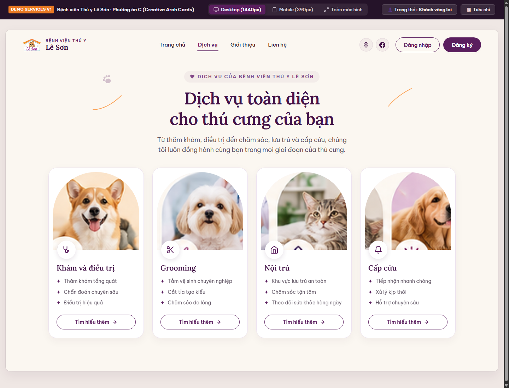
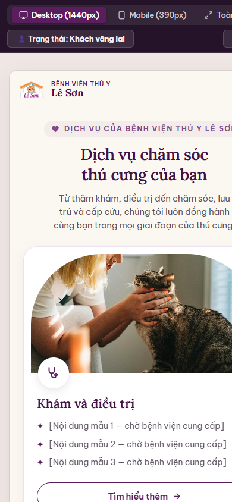

# Bàn giao Thiết kế Trang Dịch vụ — Services V1 (Phương án C: Creative Arch Cards)

**Dự án:** Bệnh viện Thú y Lê Sơn  
**Đơn vị thực hiện:** Antigravity (UI/UX Specialist)  
**Nhánh làm việc:** `antigravity/services-v1`  
**Phiên bản:** Services V1.0  
**Trạng thái:** **Chờ rà soát và chờ chủ dự án duyệt**  
**Quy trình áp dụng:** Antigravity bàn giao → Claude QA (Codex kiểm tra bổ sung nếu cần) → Claude tổng hợp → Chủ dự án duyệt

---

## 1. Giới thiệu Định hướng Giao diện (Phương án C)

Theo quyết định định hướng của Chủ dự án, Trang Dịch vụ của Bệnh viện Thú y Lê Sơn áp dụng **Phương án C — Creative Arch Cards (Thẻ Khung Vòm Sáng Tạo)**.

Thiết kế này mang lại:
1. **Tính kế thừa tự nhiên từ Hero V1:** Tiếp nối ngôn ngữ hình học khung vòm đặc trưng của Lê Sơn, tạo cảm giác thân thiện, bảo bọc và ấm áp như một ngôi nhà an toàn cho thú cưng.
2. **Cân đối trên Desktop 1440px:** 4 thẻ dịch vụ chính được dàn ngang trên một hàng đồng đều, tỷ lệ thanh thoát, không chen chúc.
3. **Thoáng đãng trên Mobile 390px & 360px:** Các thẻ tự động chuyển sang bố cục xếp dọc 1 cột, giữ trọn vẹn kích thước chữ, hình ảnh và vùng bấm nút tối ưu cho ngón tay cái.
4. **Trợ năng & Tương tác:** Hỗ trợ điều hướng bàn phím đầy đủ, viền focus tương phản cao (≥ 3:1 WCAG AA), modal xem chi tiết dịch vụ có bẫy tiêu điểm xoay vòng.

---

## 2. Hình ảnh Xem thử Thực tế (Visual Previews)

### 2.1. Giao diện Desktop 1440px


### 2.2. Giao diện Mobile 390px (iPhone 15)


---

## 3. Danh mục 4 Dịch vụ Trọng tâm

Tuân thủ nghiêm ngặt yêu cầu thiết kế của Chủ dự án: **Chỉ hiển thị 4 dịch vụ chính, không tự thêm giá, không chia dịch vụ con phức tạp, không đưa cam kết 24/7 chưa được xác nhận.**

| # | Tên Dịch vụ | Icon | Tông màu vòm | 3 Điểm nổi bật chính | Hành động |
|---|---|:---:|:---:|---|---|
| **1** | **Khám và điều trị** | Ống nghe (`stethoscope`) | Cam phấn `#FDF2E8` | ✦ Thăm khám tổng quát<br>✦ Chẩn đoán chuyên sâu<br>✦ Điều trị hiệu quả | `Tìm hiểu thêm →` |
| **2** | **Grooming** | Cây kéo tỉa lông (`scissors`) | Xanh pastel `#EDF6F7` | ✦ Tắm vệ sinh chuyên nghiệp<br>✦ Cắt tỉa tạo kiểu<br>✦ Chăm sóc da lông | `Tìm hiểu thêm →` |
| **3** | **Nội trú** | Ngôi nhà (`home`) | Kem tím `#F7EFF5` | ✦ Khu vực lưu trú an toàn<br>✦ Chăm sóc tận tâm<br>✦ Theo dõi sức khỏe hàng ngày | `Tìm hiểu thêm →` |
| **4** | **Cấp cứu** | Chuông báo khẩn (`siren`) | Tím hồng `#F8ECF3` | ✦ Tiếp nhận nhanh chóng<br>✦ Xử lý kịp thời<br>✦ Hỗ trợ chuyên sâu | `Tìm hiểu thêm →` |

> [!NOTE]
> *Tại thẻ Nội trú, Antigravity đã chủ động thay đổi cụm từ "Chăm sóc 24/7" (trong bản phác thảo) thành **"Chăm sóc tận tâm"** để tuyệt đối tuân thủ Yêu cầu số 9 của Chủ dự án về việc không đưa ra cam kết hoạt động 24/7 chưa được xác nhận.*

---

## 4. Bảng Kiểm Tra Tuân thủ 10 Yêu cầu Thiết kế

| STT | Yêu cầu của Chủ dự án | Tình trạng thực hiện | Chi tiết triển khai |
|:---:|---|:---:|---|
| **1** | Giữ nguyên Header đã duyệt trong Hero V1 | **Đã thực hiện** | Tái sử dụng nguyên vẹn Header: Logo trong suốt, Menu 4 mục, cụm Đăng nhập/Đăng ký/User dropdown, Drawer mobile bẫy tiêu điểm. Tab "Dịch vụ" được kích hoạt trạng thái `active` (`aria-current="page"`). |
| **2** | Tiêu đề lớn, typography & màu sắc đồng bộ Hero | **Đã thực hiện** | Eyebrow `♥ DỊCH VỤ CỦA BỆNH VIỆN THÚ Y LÊ SƠN`, Tiêu đề H1 font `Lora` màu `#421247` (13.96:1), mô tả font `Be Vietnam Pro` màu `#5E5362` (6.81:1). |
| **3** | Chỉ hiển thị 4 thẻ dịch vụ chính | **Đã thực hiện** | Khám & Điều trị, Grooming, Nội trú, Cấp cứu. Không thêm dịch vụ ngoài phạm vi. |
| **4** | Mỗi thẻ có ảnh vòm, icon, tên, mô tả ngắn, nút "Tìm hiểu thêm" | **Đã thực hiện** | Khung vòm bo góc đỉnh cong `120px 120px 0 0`, icon tròn nổi bật `52×52px`, tên H2 `Lora`, 3 gạch đầu dòng điểm nhấn và nút pill `Tìm hiểu thêm →`. |
| **5** | Desktop: 4 thẻ trên một hàng cân đối | **Đã thực hiện** | Bố cục `grid-template-columns: repeat(4, 1fr); gap: 24px;` căn giữa trong khung nhìn `1200px`. |
| **6** | Mobile: xếp dọc, không ép 4 thẻ vào 1 hàng | **Đã thực hiện** | Tại màn hình ≤ 680px và chế độ mô phỏng 390px: `grid-template-columns: 1fr; gap: 20px;`, các thẻ hiển thị trọn vẹn, chữ to rõ ràng, không co hẹp. |
| **7** | Họa tiết dấu chân và đường cong chỉ làm điểm nhấn | **Đã thực hiện** | Nét cong cam thanh mảnh (`#FC9238`, stroke 1.8px) và dấu chân tím mờ (opacity 0.25) nằm ngoài lề, không cắt ngang chữ hay che khuất thẻ. |
| **8** | Hover, focus, active rõ ràng; hỗ trợ bàn phím | **Đã thực hiện** | Hover card nhấc lên 6px, ảnh zoom 1.05 nhẹ nhàng; viền focus kép tím sẫm `#421247` đạt chuẩn WCAG SC 1.4.11 (13.96:1 trên kem); Modal chi tiết có bẫy tiêu điểm và phím ESC. |
| **9** | Không tự thêm giá, cam kết 24/7 hay thông tin chưa xác nhận | **Đã thực hiện** | Toàn bộ thẻ không hiển thị giá tiền, không dùng từ "24/7", câu từ trung thực, chuẩn mực y tế. |
| **10** | Demo dữ liệu giả, chưa nối backend | **Đã thực hiện** | Dữ liệu demo tĩnh dạng JSON giả lập trong `services.js`, chạy độc lập không phụ thuộc backend hay API ngoài. |
| **11** | Tích hợp liên kết Google Maps & Facebook thực tế | **Đã thực hiện** | Tích hợp biểu tượng chỉ đường Google Maps (`https://maps.app.goo.gl/xFbQ4BjKtGVa3rp86`) và Fanpage Facebook (`https://www.facebook.com/benhvienthuyleson?locale=vi_VN`) trên Header Desktop, Mobile Drawer và Modal dịch vụ; thiết lập hồ sơ phòng khám tại `docs/thong-tin-benh-vien-le-son.md`. |

---

## 5. Hướng dẫn Trải nghiệm Bản Demo

Bản demo Dịch vụ V1 được lưu trữ tại:
👉 [`demo/services.html`](../demo/services.html)

Khởi chạy máy chủ cục bộ:
```bash
node server.js
# hoặc: python -m http.server 3030 --directory demo
# Truy cập: http://127.0.0.1:3030/services.html
```

### Các thao tác thử nghiệm đề xuất:
1. **Chuyển đổi Desktop / Mobile:** Bấm chọn `Desktop (1440px)` hoặc `Mobile (390px)` trên thanh công cụ màu tím để quan sát bố cục 4 cột ⇋ xếp dọc 1 cột.
2. **Khám phá chi tiết dịch vụ:** Bấm nút `Tìm hiểu thêm →` trên từng thẻ để mở cửa sổ chi tiết mô phỏng. Dùng phím `Escape` hoặc bấm nút `✕` để đóng và kiểm tra tiêu điểm được hoàn trả chính xác về nút đã bấm.
3. **Thử nghiệm bàn phím:** Dùng phím `Tab` để di chuyển qua từng thẻ và nút, quan sát viền focus tím sẫm nổi bật sắc nét.
4. **Kiểm tra Header & Drawer:** Mở Mobile Drawer để thấy tab `Dịch vụ` đang được active, bấm `Trang chủ` để chuyển về Hero V1.
