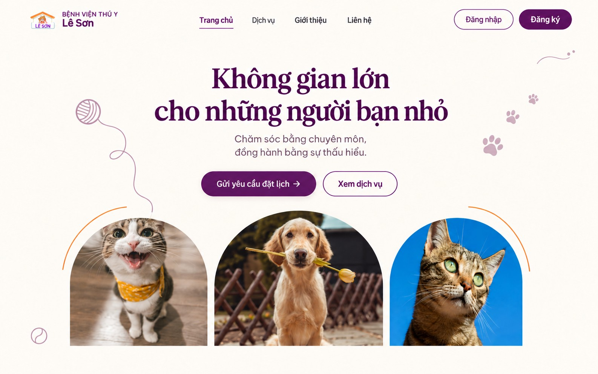

# Hero — bản thiết kế chủ dự án chốt 15/10/2026

## Antigravity triển khai

- Tiêu đề: **Không gian lớn cho những người bạn nhỏ**.
- Bỏ hàng ghi chú dưới hai nút Hero như [yêu cầu trước](yeu-cau-chinh-hero-chu-du-an-2026-10-15.md).
- Hai cung cam mảnh ôm phía ngoài hai ảnh bên, chừa khe đều; không đè ảnh/chữ.
- Cuộn len bên trái và sợi nối **cùng màu tím nhạt**, không dùng sợi cam. Cuộn len nhỏ, sợi cong nhẹ hướng xuống ảnh trái.
- Bên phải: ba dấu chân tím nhạt, nhỏ dần, đặt ngoài vùng chữ/nút.
- Góc dưới trái: quả bóng nhỏ nét tím nhạt.
- Góc trên phải: nét cong ngắn và hai chấm nhỏ tím nhạt như ảnh mẫu.
- Giữ trang trí nhẹ, tĩnh; không thêm rung/nhấp nháy lặp. Không thêm nội dung hoặc biểu tượng khác.

## Giới hạn của ảnh tham khảo

Ảnh AI chỉ dùng tham khảo **bố cục và trang trí**. Dùng logo chính thức, ảnh gốc và kiểu chữ hiện có trong repo; không lấy logo/ảnh được AI tái tạo làm tài nguyên web. Dựng trang trí bằng SVG/CSS, không dùng cả ảnh phác thảo làm nền.

## Kiểm tra trước khi bàn giao

Ở 1440, 1024, 390, 360 px: không tràn ngang, không che chữ/nút/ảnh. Mobile có thể thu nhỏ hoặc ẩn họa tiết góc để giữ tiêu đề và nút rõ. Giữ chức năng hai nút, header, luồng tài khoản. Gửi commit và ảnh desktop/mobile để chủ dự án xem.

Chủ dự án đã chốt bản này trong chat. Codex đăng ảnh và yêu cầu triển khai, chưa sửa code hoặc merge.
