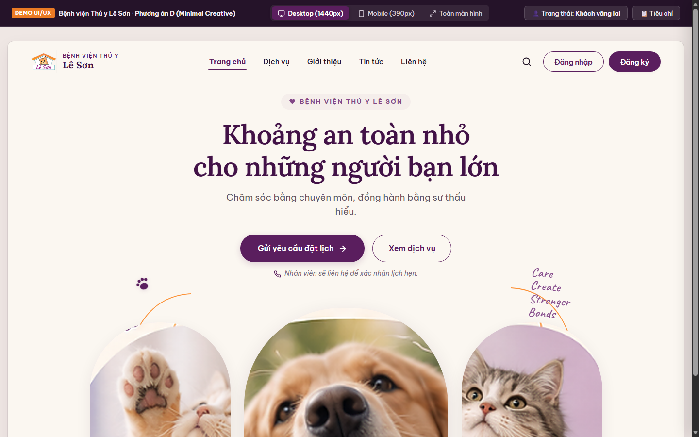
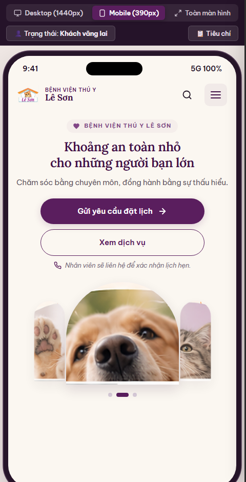

# Báo cáo Thiết kế Hero & Header — Phương án D (Minimal Creative)
**Dự án:** Bệnh viện Thú y Lê Sơn  
**Đơn vị thực hiện:** Antigravity (UI/UX Specialist)  
**Phối hợp:** Claude, Codex, ChatGPT & Chủ dự án  
**Trạng thái:** **Chờ rà soát và chờ chủ dự án duyệt**  
**Nhánh làm việc:** `antigravity/hero-v1`  
**Phiên bản:** V1.1 (Cập nhật sau đợt rà soát đầu kỳ)

---

## 1. Cập nhật Phạm vi Thiết kế chính thức (Phase 1)

Theo các quyết định đã thống nhất cùng nhóm AI và Chủ dự án:
1. **Giao diện Hero chính thức Phase 1:** Hoàn thiện trọn vẹn **Phương án D — Minimal Creative** với bố cục **3 Khung ảnh vòm thú cưng sáng tạo**.
2. **Không triển khai animation chuyển đổi tư thế mèo:** Tạm hoãn tính năng hoạt họa mèo đổi 3 tư thế giữa các trang sang giai đoạn sau (Phase 2+) để đảm bảo tiến độ hoàn thiện Hero & Header.
3. **Bảo tồn toàn bộ tài nguyên SVG:** Toàn bộ các bản vẽ vector linh vật (Bóng mèo duỗi thảnh thơi, Mèo Cartoon Bé Cam, Mèo Dancing Monoline) đã được lưu trữ an toàn trong thư mục `assets/` và `demo/assets/` để sẵn sàng cho Phase 2+.
4. **Quy chuẩn bố cục & Trợ năng:** Tuyệt đối không chồng lấn chữ, nút bấm và hình ảnh; giao diện thoáng đãng, ấm áp, chuẩn Mobile-First và WCAG 2.1 AA (chữ nhỏ tương phản ≥ 4.5:1, viền focus bàn phím ≥ 3:1).

---

## 2. Hình ảnh Giao diện Thực tế Phương án D (Minimal Creative)

### 2.1. Giao diện Desktop 1440px


### 2.2. Giao diện Mobile 390px (iPhone 15)


---

## 3. Các Điểm Ưu Việt của Giao diện Minimal Creative

1. **Bố cục phân tầng mạch lạc:**
   - **Header:** Logo Lê Sơn chính thức trong suốt, điều hướng 4 mục trọng tâm (Trang chủ, Dịch vụ, Giới thiệu, Liên hệ), cụm xác thực (Khách vãng lai & Đã đăng nhập).
   - **Hero:** Eyebrow trang trọng `♥ BỆNH VIỆN THÚ Y LÊ SƠN`, tiêu đề chính H1 `Khoảng an toàn nhỏ / cho những người bạn lớn` căn giữa thanh lịch. Dòng mô tả áp dụng `text-wrap: balance` tránh rớt chữ đơn lẻ.
   - **CTA Group:** Nút chính `Gửi yêu cầu đặt lịch →` bo góc êm ái, nút phụ `Xem dịch vụ`.
   - **Cụm chú thích bảo đảm & không cần tài khoản:** Nêu rõ `📞 Nhân viên sẽ liên hệ để xác nhận lịch hẹn.` và `👤 Không cần tài khoản để gửi yêu cầu.` ngay trên màn hình đầu tiên, không bắt buộc người dùng phải mở menu.
2. **Ba khung ảnh vòm chạm đáy (Three Arched Frames):**
   - Sử dụng ảnh gốc chất lượng cao, hình chữ nhật chưa cắt khung từ Unsplash, để CSS bo vòm tự nhiên, không có viền kem nướng sẵn hay vệt sáng đáy:
     - Khung 1 (Trái): Chú mèo mướp vui tươi đeo khăn vàng (`demo/assets/pet-left.png`).
     - Khung 2 (Giữa - Trọng tâm): Chú chó Golden Retriever ngậm hoa tulip (`demo/assets/pet-center.png`, độ phân giải thật 960×845 px).
     - Khung 3 (Phải): Bé mèo mướp mắt xanh ngước nhìn (`demo/assets/pet-right.png`).
   - Họa tiết trang trí: Vòng cung cam mỏng (`#FC9238`) đối xứng hai bên, dấu chân tím nhỏ tinh tế, không cắt ngang chữ hay khung hình.
3. **Trải nghiệm di động chuẩn Mobile-First (390px & 360px):**
   - Không ép 3 ảnh nhỏ vào một hàng gây rối mắt. Khung ảnh trung tâm nổi bật, hai ảnh bên thu gọn nhẹ nhàng kèm bộ chuyển đổi chấm tròn tương tác 1 chạm. Trên Desktop, bộ chấm tròn ẩn hoàn toàn.
   - Chiều cao Header đồng nhất ở cả trạng thái Khách vãng lai và Đã đăng nhập (64px, độ lệch 0px). Tên người dùng dài được ẩn chữ trên mobile để hiển thị avatar gọn gàng, nút bấm luôn đạt tối thiểu 44×44px.
   - Menu Drawer mở êm ái, bẫy tiêu điểm phím Tab, hỗ trợ đóng bằng phím Escape và hoàn trả tiêu điểm chuẩn WCAG 2.1 AA.

---

## 4. Cách Trải Nghiệm Bản Demo Tương Tác Trực Tiếp

Bản demo giao diện chạy độc lập, có thể mở trực tiếp tệp:
👉 [`demo/index.html`](../demo/index.html)

Hoặc khởi chạy máy chủ thử nghiệm cục bộ:
```bash
# Khởi chạy máy chủ HTTP phục vụ thư mục demo
python -m http.server 3030 --directory demo
# Truy cập: http://localhost:3030
```

### Thao tác thử nghiệm nhanh:
1. **Chuyển đổi Khung nhìn:** Bấm chọn `Desktop (1440px)`, `Mobile (390px)` hoặc `Toàn màn hình` trên thanh công cụ màu tím.
2. **Kiểm tra trạng thái Tài khoản:** Bấm `👤 Trạng thái: Khách vãng lai` để hoán đổi với trạng thái đã đăng nhập (`Khách Demo`). Dropdown hỗ trợ đóng bằng phím Escape.
3. **Thao tác Bàn phím (Accessibility):** Dùng phím `Tab` để di chuyển tiêu điểm, mở Menu Drawer trên Mobile và dùng phím `Escape` để đóng; kiểm tra vòng lặp tiêu điểm bên trong menu.
4. **Xem Bảng Tiêu chí & Token:** Bấm nút `📋 Tiêu chí` để kiểm tra đối chiếu các thông số thiết kế kỹ thuật.

---

## 5. Danh mục Lưu trữ Tài nguyên cho Giai đoạn sau (Phase 2+ Backlog)

Các tệp vector linh vật mèo phục vụ tính năng chuyển đổi tư thế giữa các trang đã được lưu trữ đầy đủ tại:
- [`assets/cat-silhouette.svg`](../assets/cat-silhouette.svg) — Silhouette duỗi thảnh thơi (Trang chủ)
- [`assets/cat-pose-services.svg`](../assets/cat-pose-services.svg) — Silhouette chỉ chân khám phá (Dịch vụ)
- [`assets/cat-pose-booking.svg`](../assets/cat-pose-booking.svg) — Silhouette vẫy chân chào mừng (Đặt lịch)
- [`assets/sketch-cartoon-cat.svg`](../assets/sketch-cartoon-cat.svg) — Phác thảo Cartoon Bé Cam
- [`assets/cat-dancing-monoline-pure-v7.svg`](../assets/cat-dancing-monoline-pure-v7.svg) — Mèo Dancing Monoline thuần khiết
- [`assets/cat-dancing-monoline-brand-v7.svg`](../assets/cat-dancing-monoline-brand-v7.svg) — Mèo Dancing Monoline nhận diện Lê Sơn
