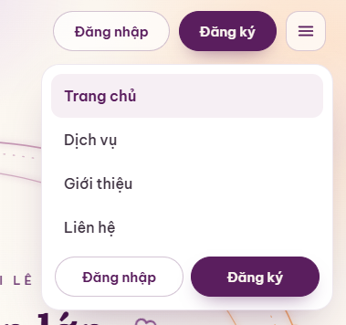

> **Đã thay thế (15/10/2026):** đặc tả chốt và việc giao Codex tích hợp ở [dac-ta-header-mobile-2026-10-15.md](dac-ta-header-mobile-2026-10-15.md). Mục này không giao Antigravity.

> **Cập nhật phân công:** Thiết kế đã chuyển sang Claude theo [quyết định chủ dự án](phan-quyen-thiet-ke-giao-claude-2026-10-15.md). Antigravity chưa được triển khai tiếp mục này; ảnh và tiêu chí dưới đây vẫn giữ làm đầu vào thiết kế.

# Giao Antigravity: header mobile và menu xổ xuống theo ảnh chủ dự án chọn

Chủ dự án chốt ngày 15/10/2026: “tôi thích kiểu header trên mobile như này giao cho antigravity lm kiểu vậy đi”. Codex ghi lại yêu cầu và ảnh gốc; đây là việc giao thiết kế, chưa phải bản triển khai hoặc QA đạt.

**Người làm:** Antigravity. **Nhánh triển khai:** `antigravity/design`. Không merge, không deploy. Claude kiểm sau khi bàn giao; Antigravity chỉ tự kiểm nhanh đúng phạm vi.

## Ảnh làm chuẩn

Ảnh là phần cắt khu vực thao tác/menu, không phải quyết định bỏ logo. Giữ logo chính thức và nội dung đã chốt. Không tự suy ra thay đổi desktop hoặc trạng thái tài khoản từ phần không có trong ảnh.

## Cần làm

- Header mobile giữ hai nút dạng viên thuốc: **Đăng nhập** nền sáng, viền tím mảnh; **Đăng ký** nền tím, chữ sáng; nút ☰ bên phải trong ô bo góc nền sáng. Căn chỉnh, khoảng cách, bo góc, màu và bóng theo ảnh.
- Bấm ☰ mở **hộp menu xổ xuống ngay dưới header**, thay cách trình bày drawer trượt cạnh trên mobile. Hộp nền trắng, bo góc lớn, có đệm và bóng nhẹ, không đẩy nội dung Hero xuống.
- Các liên kết xếp dọc: Trang chủ, Dịch vụ, Giới thiệu, Liên hệ. Trang hiện tại có nền tím rất nhạt và chữ tím đậm như dòng Trang chủ trong ảnh; ở Dịch vụ đánh dấu đúng Dịch vụ.
- Cuối hộp có hàng Đăng nhập/Đăng ký đặt cạnh nhau như ảnh trong trạng thái khách. Hai nút tài khoản trên header vẫn hiện khi menu đóng hoặc mở.
- Dùng chung giao diện header/menu cho Trang chủ và Dịch vụ; áp dụng cả viewport mobile thật và khung xem thử Mobile 390.
- Giữ nguyên hành vi mô phỏng tài khoản: khi đã đăng nhập dùng nút tài khoản/menu tương ứng đã có, không ép hiện nút dành cho khách. Không tự xây đăng nhập, đăng ký hoặc backend.

## Giới hạn và nền mã

- Hero chính hiện có trên `codex/hero-chinh-quy-dao`, bản sửa 1: `6aaabc84d1daa133e45f378a84287ae013fc291d`. Đọc cùng yêu cầu [Hero chính](yeu-cau-hero-chinh-khung-anh-bay-vong-2026-10-15.md).
- Chỉ sửa header/menu mobile và CSS/JS cần cho tương tác của menu. Không đổi bộ mô phỏng Hero, quỹ đạo, nhịp chuyển động, CTA, nội dung hoặc bố cục Hero; không thay đổi bộ điều khiển xem thử.
- Không ghi đè Hero mới bằng Hero cũ và không merge các nhánh để nhận việc này. Nếu nền nhánh thiết kế còn khác bản Hero chính, ghi rõ khi bàn giao; không tự gom thêm việc ngoài header.
- Giữ liên kết hiện có; Đăng nhập/Đăng ký và form đặt lịch vẫn là phần giữ chỗ đã chốt. Không thêm menu mới hoặc bỏ logo chỉ để vừa màn hình.

## Đạt khi và bàn giao

1. Menu mở nhìn giống ảnh ở 360 và 390px: dạng hộp xổ xuống, thứ tự liên kết và hai nút cuối hộp đúng; header không bị menu che.
2. Ở 320, 360, 390, 420px và khung Mobile 390: không tràn ngang; logo, hai nút khách, nút ☰ không đè nhau; vùng chạm nút cao tối thiểu 44px. Kiểm cả khách và đã đăng nhập trên hai trang.
3. Bấm ☰ mở/đóng; Escape đóng và trả tiêu điểm về nút mở; bấm ngoài đóng. Tab/Shift+Tab có thứ tự hợp lý, focus rõ; trạng thái aria-expanded và aria-controls đúng, menu đóng không nhận focus. Không làm hỏng điều hướng bàn phím hiện có.
4. Desktop giữ giao diện/hành vi đã có; không đổi hành vi bộ mô phỏng Hero. Tự kiểm nhanh cả Trang chủ và Dịch vụ do header dùng chung.
5. Bàn giao branch, SHA đầy đủ, danh sách tệp đổi, ảnh header/menu đóng và mở ở 360/390px, ảnh khung Mobile 390; ghi rõ đã kiểm/chưa kiểm để Claude kiểm lại. Không tự kết luận chủ dự án đã duyệt bản triển khai.
